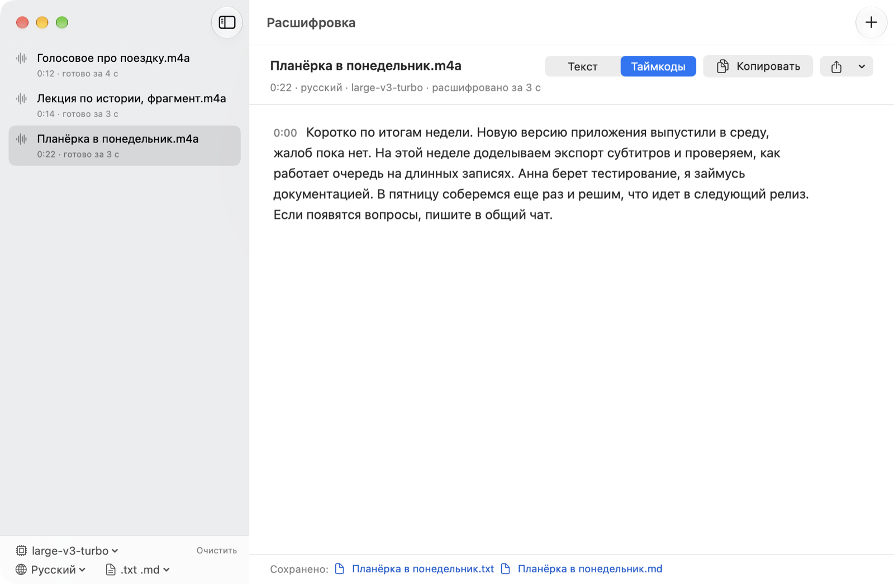

# Расшифровка

Приложение для macOS, которое превращает голосовые, аудио и видео в текст и субтитры. Распознавание
идёт на вашем Mac через [whisper.cpp](https://github.com/ggml-org/whisper.cpp), звук никуда не
отправляется. Интерфейс на русском.

*A native macOS app for local speech-to-text with whisper.cpp: drop voice messages or videos, get
text, Markdown with timestamps or subtitles. UI in Russian.*



## Что умеет

- Принимает файлы перетаскиванием в окно или на иконку в Доке, через «Открыть с помощью» в Finder
  и кнопку «+». Можно сразу несколько файлов или папку. Подходят OGG из Telegram, M4A, MP3, WAV,
  MP4, MOV и всё, что читает ffmpeg.
- Обрабатывает очередь в фоне, текст появляется по ходу распознавания.
- Сохраняет результат рядом с исходником: `.txt` и `.md` с таймкодами по умолчанию, по желанию
  субтитры SRT и VTT и JSON с сегментами. Любой формат можно выгрузить позже без повторного прогона.
  Существующие файлы не перезаписываются.
- Скачивает модели whisper прямо из настроек (с HuggingFace, с проверкой SHA-256) и переключает их
  из главного окна.
- Пишет имена и термины так, как вы их зададите в настройках.
- Убирает то, что whisper выдумывает на тишине («Спасибо за субтитры…», «Продолжение следует»,
  `[музыка]`), и предупреждает, если распознавание зациклилось или речь оборвалась на середине.
- Щадящий режим: два потока и низкий приоритет, чтобы Mac не тормозил во время длинных записей.

## Установка

Нужны macOS 14 или новее на Apple Silicon, Command Line Tools (`xcode-select --install`; полный
Xcode не нужен) и Homebrew.

```bash
brew install whisper-cpp ffmpeg
git clone https://github.com/laughinme/transcriber.git
cd transcriber
make install        # собирает приложение и кладёт его в /Applications
```

При первом запуске приложение предложит скачать модель. Рекомендуемая Large v3 Turbo весит 1,6 ГБ:
час записи расшифровывается примерно за 5 минут на M-серии. Модели лежат в `~/.whisper`, туда же
можно положить свои `ggml-*.bin`, они появятся в списке.

## Разработка

```bash
make test        # тесты ядра, доли секунды
make test-e2e    # плюс прогон настоящего whisper и скачивание модели детектора речи
make run         # собрать и открыть без установки
```

```text
Sources/TranscriberCore/   без UI: поиск whisper-cli, ffmpeg и моделей, запуск, разбор вывода,
                           чистка и проверка качества, форматы, каталог и загрузка моделей
Sources/Transcriber/       SwiftUI: очередь, окно расшифровки, настройки, приём файлов из Finder
Tests/                     swift-testing
scripts/                   упаковка .app, иконка рисуется кодом
```

Каждый файл ffmpeg переводит в WAV 16 кГц моно, потом whisper-cli распознаёт его с детектором
речи Silero и подсказкой для пунктуации, которая повторяется в каждом 30-секундном окне. Почему
выбраны именно такие параметры: [docs/DECISIONS.md](docs/DECISIONS.md). Правила для
ИИ-агентов, которые работают с кодом: [AGENTS.md](AGENTS.md).

История расшифровок хранится в `~/Library/Application Support/Transcriber/history.json`.

## Лицензия

MIT. Модели whisper распространяются OpenAI под MIT, детектор речи Silero под MIT.
